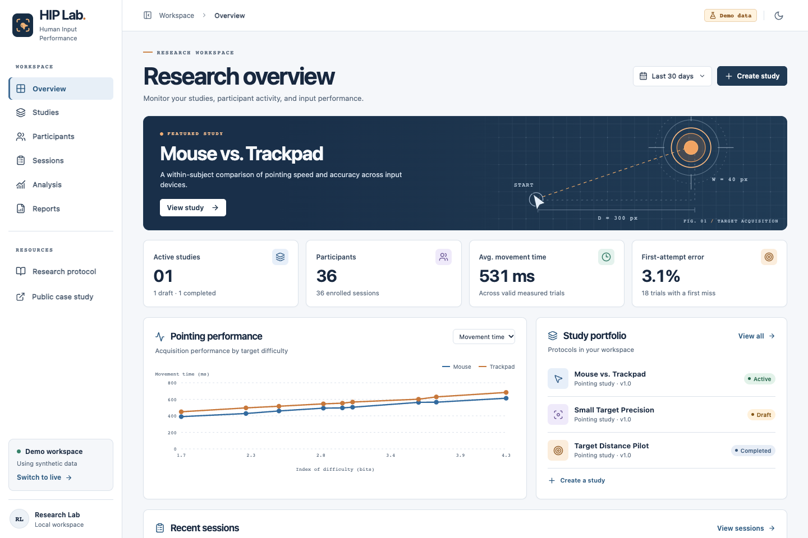

# Human Input Performance Lab

HIP Lab is a local research instrument for a within-participant mouse-versus-trackpad pointing study. Researchers define a protocol, enroll consenting participants, inspect event-level records, analyze paired observations, and export aggregate reports. The public case study contains no participant findings.



[Research protocol](RESEARCH_PROTOCOL.md) · [Statistical methodology](docs/methodology.md) · [Analysis notebook](analysis/notebooks/pointing.ipynb) · [MIT license](LICENSE)

## Run on macOS

Use Node.js 22.13+ or 24, npm, Python 3.12+ and uv. The checked-in npm and uv lockfiles pin dependencies. From this repository:

```sh
uv sync --locked --extra test --extra analysis
npm --prefix frontend ci
cp -n .env.example .env
chmod 600 .env
```

Edit the local `.env` and set `HIP_RESEARCHER_PASSWORD` to a unique password of at least 12 characters. Then start the database and API from the repository root:

```sh
.venv/bin/alembic -c backend/alembic.ini upgrade head
.venv/bin/uvicorn backend.hip.main:app --host 127.0.0.1 --port 8000 --no-access-log
```

In a second terminal, from the repository root:

```sh
npm --prefix frontend run dev
```

Open [the workspace](http://127.0.0.1:3000). The default dashboard has a labeled synthetic dataset of 36 sessions, 581 measured trials and 575 valid trials. The demo works with the frontend alone. Its fixed date window ends November 12, 2026. Changing the date range uses that reference date.

### Conduct a session

1. Select **Switch to live** and sign in. A new database has no studies or participant data.
2. Choose **Create study**, review the inclusion criteria, hypothesis, planned sample size, dimensions, repetitions, data capture and retention. Set the study to **Active** and save. Enrollment locks the protocol's measurement settings.
3. Open the study and copy the **Participant session** link. For a shared lab computer, open it in a separate participant browser profile. The authenticated researcher profile can access private records.
4. Complete consent and both device blocks with a desktop or laptop, a mouse and a trackpad. The participant confirms the device before each block. The start-target down event starts the clock. Completion, first attempts, retries and interruptions have distinct fields.
5. Use **Sessions** to review trial counts, inspect pointer traces, document exclusions or verify the devices. Use **Analysis** for descriptive filters and the full-study paired analysis. **Reports** exports private raw CSV/JSON and aggregate PDFs.
6. Participants can withdraw and delete their enrollment. A researcher can locate the participant by pseudonym and delete the session. End the participant browser session before handing the device to another person.

The practice instrument at [/session](http://127.0.0.1:3000/session) runs a short in-memory rehearsal. The [public case study](http://127.0.0.1:3000/case-study) explains the design, hypotheses and limitations.

### Run a moderated usability study

Open **Moderated usability** from the workspace sidebar and sign in. Create a study with a research objective, an ordered list of participant tasks, and a retention period. Add an optional web or prototype link for software tasks. For hardware tasks, describe the physical action in the prompt.

Open the participant link in a separate browser profile on the lab computer. After consent, the participant starts each task and can request review. In the researcher window, select **Monitor** to see progress, add timestamped private notes, and score each task as completed independently, completed with help, or abandoned. The score advances the participant to the next prompt. Both views poll the local API every two seconds. Observe behavior in person or through a separately arranged screen share; HIP Lab records explicit workflow events, without recording the participant’s screen.

Export the private session timeline as JSON from the monitor. It includes UTC server timestamps, consent time and task positions. These timestamps describe moderation activity and include human response delays. Participants can withdraw or delete their session under **Participation controls**. A participant receipt survives a reload in the same tab. Researchers can also delete the enrollment and its notes. The pointing-study dashboards and Fitts models use only pointing data.

For an existing install, run `.venv/bin/alembic -c backend/alembic.ini upgrade head` and restart the API before opening the moderated workspace.

## Work in PyCharm

Open the repository root as the project. After running the setup commands above, select the existing interpreter at `.venv/bin/python` in the project’s Python Interpreter settings. The shared run configurations in `.run/` use this interpreter and the repository working directory.

| Run configuration | What you can do |
| --- | --- |
| HIP Lab - Synthetic analysis | Generate a PDF, PNG/SVG figures and a provenance manifest in `artifacts/demo/`. Set a breakpoint in `paired_estimate` in `analysis/hip_analysis/model.py` and choose **Debug** to inspect the participant-level contrasts. |
| HIP Lab - Research API | Run or debug FastAPI on port 8000 after migrating the database. Start the frontend from the PyCharm terminal with `npm --prefix frontend run dev`. |
| HIP Lab - Python tests | Run the backend and analysis suites against disposable fixtures. |

For notebook work, open `analysis/notebooks/pointing.ipynb` with the same Python environment. The example begins with synthetic records. Generated artifacts and personal IDE settings are ignored by Git.

## Reproduce analysis

```sh
PYTHONPATH=analysis .venv/bin/python -m hip_analysis --demo --out /tmp/hip-example --figures --pdf
.venv/bin/python analysis/generate_demo.py --check
.venv/bin/jupyter lab analysis/notebooks/pointing.ipynb
```

For live data, replace `--demo` with `--input /path/to/export.json`. Set `--widths` and `--distances` to the actual protocol levels. Supply the frozen protocol JSON with `--protocol` for a report containing your objectives and hypotheses. The CLI writes an exclusion ledger, a provenance manifest with an input hash, a PDF, and private PNG/SVG figures. The notebook resolves the analysis package from the checkout.

## Verify

```sh
.venv/bin/pytest -q
.venv/bin/ruff check backend analysis scripts
.venv/bin/mypy backend/hip analysis/hip_analysis
npm --prefix frontend run lint
npm --prefix frontend run typecheck
npm --prefix frontend test
npm --prefix frontend run build
(cd frontend && npx playwright install chromium)
.venv/bin/python scripts/browser_tests.py
```

The browser runner starts Next and FastAPI on loopback ports 3001 and 8001, migrates a temporary SQLite database and generates a temporary password. On macOS, an installed Chrome can also be used:

```sh
CHROME_PATH="/Applications/Google Chrome.app/Contents/MacOS/Google Chrome" .venv/bin/python scripts/browser_tests.py
```

For a locally optimized frontend use `npm --prefix frontend run build` followed by `npm --prefix frontend start`. Continue running the API on port 8000. To change its location, set `HIP_API_ORIGIN` when building the frontend. Set `HIP_FRONTEND_ORIGIN` in the backend environment when changing the frontend origin.

## Layout

| Location | Responsibility |
| --- | --- |
| frontend/app | App Router pages, public portfolio, participant screens, synthetic export endpoints |
| frontend/components | Research workspace, study builder, chart and report views, reusable controls |
| frontend/lib | Typed UI models, trial state machine, deterministic demo projection |
| backend/hip | FastAPI contracts, local authentication, SQLAlchemy storage, scoring, private exports |
| backend/migrations | Alembic revisions for SQLite and PostgreSQL-compatible models |
| analysis/hip_analysis | Validation, descriptive and paired estimates, figures, aggregate PDF |
| analysis/notebooks | Reproducible pointing analysis |
| shared | OpenAPI schema and data dictionary |
| backend/tests, analysis/tests, frontend/tests, frontend/e2e | API, analysis, state-machine and browser tests |

Architecture, milestones and acceptance criteria are in [the project plan](PROJECT_PLAN.md). For operating definitions, assumptions and exclusions, see [the research protocol](RESEARCH_PROTOCOL.md), [statistical methodology](docs/methodology.md) and [data dictionary](shared/DATA_DICTIONARY.md).

## Release scope and remaining validation

This release supports a controlled pointing-study template and an ordered moderated usability protocol. Its geometry, units, scheduling and timing definitions are software-tested. Physical-device timing calibration, usability testing with participants, assistive-technology evaluation and a real recruitment pilot remain outstanding. Automated accessibility checks cover representative flows. The timed pointing arena requires a fine pointer and sufficient space.

The local API is designed for a single trusted researcher on a lab computer. The database, exported files and browser profile inherit the operating system's storage protections. Retention runs at startup and hourly while the API runs. The researcher manages previously downloaded files and backups separately. PostgreSQL support uses SQLAlchemy and the optional `postgres` dependency group. The integration suite currently exercises SQLite.

The study-level paired contrast is the prespecified inferential test. Secondary charts are exploratory. WearLab, multi-researcher roles and network-hosted deployment remain future work.

### Verification record

The final local run passed 18 Python tests, 6 TypeScript tests and 7 Chromium browser tests. The browser suite exercised the real participant API with an isolated SQLite database, checked researcher sign-in and protocol edits, verified synthetic exports, monitored a moderated session across separate researcher and participant browsers, and ran automated accessibility checks on representative participant, desktop and mobile views. Ruff, mypy, ESLint, TypeScript and the Next.js production build passed. The deterministic fixture matched its generator. npm reported zero known advisories for the installed dependency tree.

The notebook and aggregate report were executed against synthetic data. The resulting three-page PDF was visually reviewed. Human timing calibration and real participant outcomes require a separate study.
